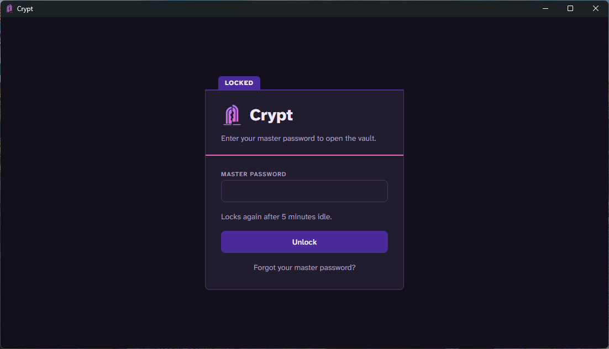
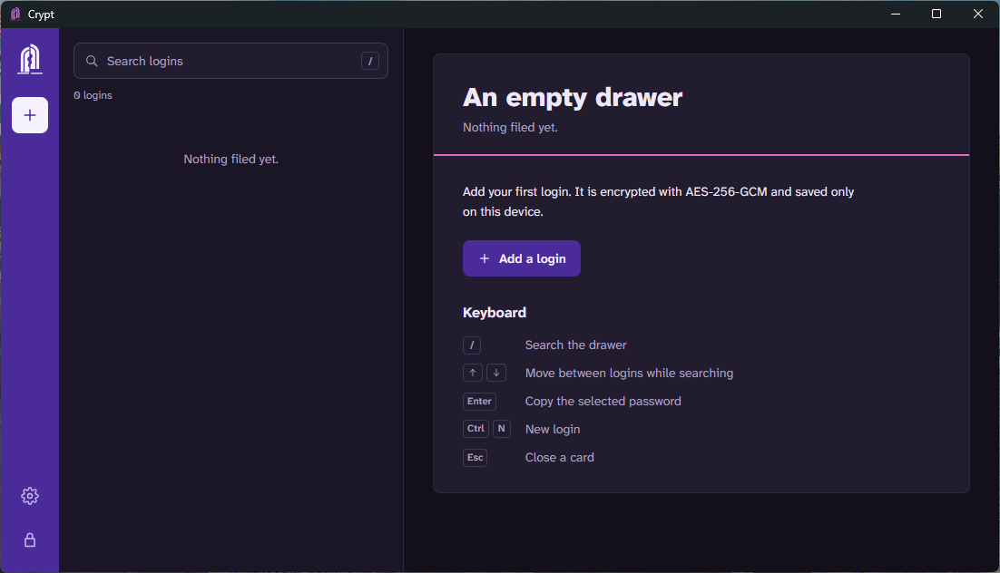
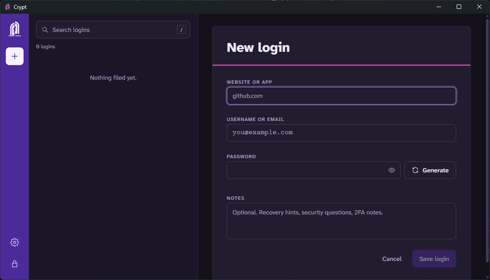
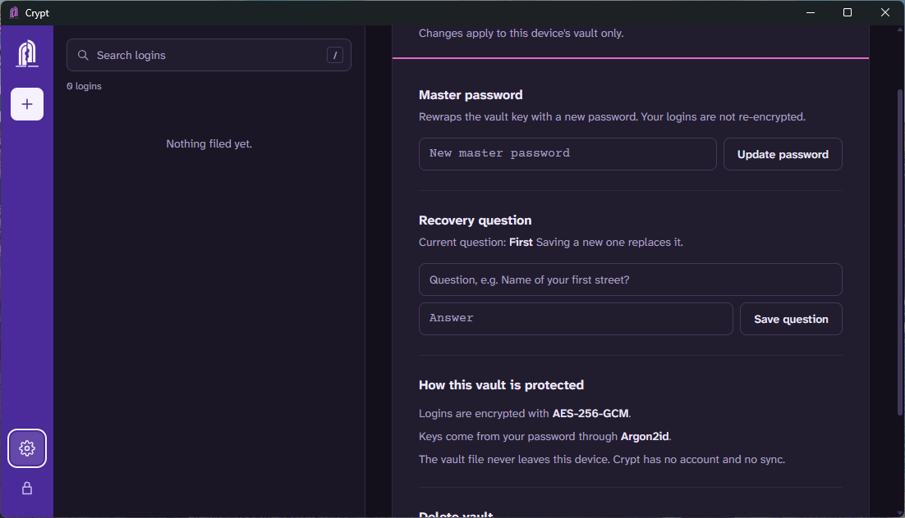

<div align="center">
  

  <h1>Crypt</h1>

  <p>Open source, local-only password manager built on Tauri + Svelte.</p>

  <p><a href="https://github.com/TAFH-debug/crypt/releases"><b>Download</b></a></p>
</div>

## Features

* **AES-256-GCM** encryption with keys derived via **Argon2id**.
* **Local only.** Your vault never leaves your device.
* **Encrypted files.** Store any file up to 100 MB. Link it to a login to see it on that card.
* **Encrypted backups.** Export logins and files into one `.cryptbak` file. Import merges a backup or another device's `vault.json` and skips duplicates.
* **Recovery question.** Reset a forgotten master password without losing data.
* **Password generator** with strength meter.
* **Auto-lock** after 5 minutes of inactivity.
* **Clipboard auto-clear** 30 seconds after copying.
* **Fast search.** Press `/` to jump to it.
* **Light and dark themes**, following your system.
* **Small native binary** (~9 MB).

## Screenshots

### Lock screen



### Vault



### Add password



### Settings



## How it works

A random data key encrypts your entries. That key is stored wrapped twice:

1. By a key derived from your master password.
2. Optionally, by a key derived from your recovery answer.

Changing the master password only rewraps the data key. Entries are not re-encrypted.

Files are encrypted with the same data key. Each one is stored as a separate blob in `files/`. Their names, sizes and links to logins are encrypted inside `vault.json`.

A backup holds the password-wrapped data key, your encrypted entries and the encrypted file blobs. It opens with the master password that was current at export time. The recovery question is left out. File count and sizes are visible in the backup header; names and contents are not.

The vault lives in your app data folder:

| OS      | Path                                          |
| ------- | --------------------------------------------- |
| Windows | `%LOCALAPPDATA%\com.crypt.app`                |
| macOS   | `~/Library/Application Support/com.crypt.app` |
| Linux   | `~/.local/share/com.crypt.app`                |

Vaults from older versions migrate automatically on first unlock.

## Build from source

Requires [Node.js](https://nodejs.org), [Rust](https://rustup.rs) and the [Tauri prerequisites](https://tauri.app/start/prerequisites/).

```bash
npm install
npm run tauri dev     # run in development
npm run tauri build   # build installers
```

## License

[MIT](LICENSE)
